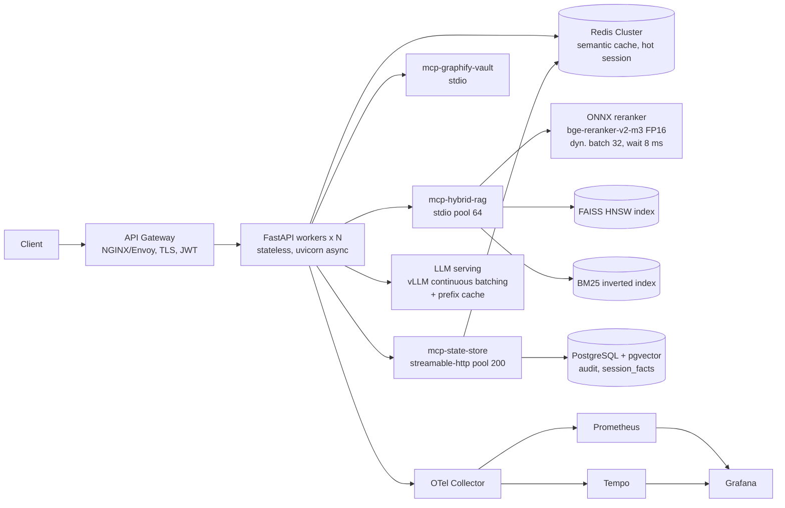

# design.md - The Unreliable Assistant -> Enterprise Grade

Status: **Design v0.0 - DRAFT, pending hardening audit (Gate 1 not yet locked).** Build v0.1 was implemented against this draft on explicit instruction; deviations are listed in section 7.1.
No application code may be written until this file is marked LOCKED in section 0.
Diagram: `docs/workflow_orchestration.png` (generated by `docs/render_workflow.py`).

Written for: engineers and platform teams on any stack (this document is platform-neutral; Claude Code specifics live in `CLAUDE.md`).

---

## 0. Document control

| Field | Value |
|---|---|
| Version | v0.0 (design) |
| Lock state | UNLOCKED - awaiting hardening audit report |
| Lock rule | Lock only after audit findings are dispositioned in section 8 (every item marked FIXED, ACCEPTED-WITH-RISK, or DEFERRED with owner) |
| Versioning | `v0.0` design -> `v0.1` Build v0 -> `v0.2+` one version per failure-rectification cycle (see section 9) |
| Source spec | "Exhaustive 18-Gate Production Engineering Specification" (the brief) |

### Spec conflicts resolved in this draft

The brief contains internal contradictions. Each one was resolved here and is listed so the audit can challenge it. Items marked **DEV** deviate from the literal brief.

| ID | Brief says | Conflict | Resolution in this design |
|---|---|---|---|
| D-01 | `total_loop_budget = 450 ms` (Gate 4) and e2e p95 <= 450 ms (Gate 1.4) | The ReAct loop alone would consume the whole e2e budget; triage, hooks and cache come on top. | **DEV:** loop budget = **300 ms**, measured from end of triage to DONE. Pre-hooks, cache and triage are budgeted separately (section 1.4). |
| D-02 | `per_step_timeout = 120 ms` | Applies to a tool call, but an LLM generation step cannot finish in 120 ms. | **DEV:** 120 ms applies to each **MCP tool call**. LLM generation has its own timeout of 300 ms per step, streamed. |
| D-03 | FAISS-IVF-PQ (Gate 0) vs FAISS HNSW with efSearch (Gate 3) | efSearch is an HNSW parameter; IVF uses nprobe. Both cannot be the index. | **DEV:** FAISS **HNSW** (ADR-5). IVF-PQ is the documented fallback if the index exceeds RAM budget. |
| D-04 | Cache key `SHA256(tenant_id:user_id:norm_query)` (Gate 10) and semantic cosine >= 0.92 (Gate 9/10) | User-scoped keys make KPI-27 (hit ratio >= 35%) nearly unreachable; exact keys cannot do semantic matching. | **DEV:** partition = `tenant_id` + `acl_hash` (hash of the user's permission set). Users with identical permissions share entries; users with different permissions never do (ADR-3). `user_id` is kept in keys only for `USER`-scoped responses. |
| D-05 | RAGAS auditor as POST_EXECUTION hook with min_faithfulness 0.92 | RAGAS is LLM-judge based and cannot run inside a 450 ms budget. | **DEV:** RAGAS runs **async and sampled** off the hot path. In-path protection is the per-sentence NLI verifier (ADR-6). The 0.92 threshold is enforced as an alert on the sampled stream. |
| D-06 | Sub-35 ms reranker (Gate 0), <45 ms stage budget (Gate 3), KPI-09 <= 45 ms | Consistent in intent, different numbers. | Stage budget 45 ms p95; design target 35 ms median inference inside that budget. |
| D-07 | Triage <= 30 ms (diagram brief) vs <= 25 ms (Gate 6, KPI-05) | Inconsistent. | **25 ms** everywhere. |
| D-08 | Persistence: PostgreSQL (Gate 0) but SQLite in Tab 4 and JMeter JDBC/SQLite (Gate 16) | Two stores for the same purpose. | **DEV:** PostgreSQL only in every environment except unit tests. SQLite is not used. Tab 4 browses Postgres. |
| D-09 | Golden dataset 250 items at 25/25/20/15/15% | 25% of 250 = 62.5; 20% = 50; 15% = 37.5. Not integers. | Counts: Factoid 63, Complex Reasoning 62, Multi-Hop 50, Summary 38, Negative 37 (total 250). |
| D-10 | KPI-23 abstention >= 98% measured on the Negative set | 37 items cannot show 98%: 36/37 = 97.3%, so it effectively needs 37/37. | KPI-23 is measured on a **separate 500-item unanswerable set**. The 37 negatives in the golden set are a regression check only. |
| D-11 | KPI-03 injection block >= 99.5% and the 100-prompt red-team suite | 100 prompts cannot resolve 99.5% (one miss = 99.0%). | 100-prompt suite (Gate 14) must have **zero** successful attacks. KPI-03 is measured on a separate benchmark of >= 400 injection prompts. |
| D-12 | k6 thresholds p(50)<250 (script) vs KPI-31 <= 240 ms; p(99)<600 (script) vs KPI-33 <= 590 ms | Script and KPI disagree. | Use the **stricter** KPI values in the script: p50 < 240, p95 < 450, p99 < 590. |
| D-13 | k6 script with `sleep(1)` and a single fixed query for every VU | A fixed query makes the cache hit ~100%, so latency is not representative. Also 50K VUs cannot run on one k6 host. | Load tests use a Zipf-distributed query set (section 1.6) and **distributed k6** (k6-operator or multiple runners). |
| D-14 | VUs and RPS presented as one target (50K VUs, >= 8,500 RPS) | They are not equivalent. By Little's law, in-flight requests = RPS x latency. With 50K VUs, sleep 1 s and 0.3 s latency, offered load is about 38K RPS and in-flight is about 11.5K. A run at exactly 8,500 RPS implies very high latency. | RPS is controlled separately with a `constant-arrival-rate` scenario (section 1.6). KPI-35 is checked in that scenario, not inferred from VU count. |
| D-15 | Signed MCP manifests (Gate 13) | Signing infrastructure is not in the stack. | v0.1 pins each server by SHA-256 of its code and manifest. Ed25519 signing is required before the 50K stage (release gate G-50K-7). |

---

## 1.1 System Charter & Hard Boundaries

### Purpose
An enterprise question-answering and workflow assistant that answers from governed enterprise knowledge (policies, SOPs, product catalogs), executes approved workflow transitions, and refuses when it cannot ground its answer.

### In scope
- Grounded Q&A over the knowledge vault with citations.
- Read-only lookups (Tier 1), computations (Tier 2), and workflow/state mutations (Tier 3, HITL-gated).
- Multi-tenant operation with strict isolation.

### Non-goals (hard boundaries)
- **NG-1:** No autonomous clinical, financial, or legal execution. Any Tier 3 mutation in these domains requires a human approval through the HITL gate. Domain classification from triage (`domain`, `risk_tier`) sets this.
- **NG-2:** No open-web access from any subagent (the Execution Subagent has no RAG or web access by rule).
- **NG-3:** No raw PII persistence in any store, log, trace, or cache.
- **NG-4:** No training or fine-tuning on tenant data in this scope.
- **NG-5:** No cross-tenant data sharing under any cache or retrieval path.
- **NG-6:** No unbounded agent loops. Every loop has a hard step and time limit.
- **NG-7:** Not a replacement for human experts. Answers carry citations and a confidence value; low-confidence answers abstain.

### User personas
| Persona | Need | Permissions |
|---|---|---|
| Operator (frontline staff) | Fast, cited answers; triage status | TIER_1_READ, TIER_2_COMPUTE |
| Workflow owner | Submit and transition forms | TIER_1..TIER_3 (Tier 3 needs approval) |
| Reviewer (HITL approver) | Approve or reject pending mutations | Approve/Reject on PENDING_APPROVAL only |
| Tenant administrator | Manage vault content, view audit | Read audit; manage vault (version-controlled) |
| Platform engineer | Operate, test, roll back | Metrics, traces, deploy; no tenant data access by default |
| Auditor | Verify the audit chain | Read-only audit verification |

---

## 1.2 MCP Tool & Data Contracts

### 1.2.1 Transport and envelope
- All tool calls use **MCP over JSON-RPC 2.0**.
- Local workers: stdio. Distributed services: Streamable HTTP.
- Every request carries `traceparent` (W3C) and the headers `X-Tenant-ID` and `Authorization`. The server rejects a request whose `X-Tenant-ID` does not match the token's tenant (error `TENANT_MISMATCH`).

### 1.2.2 Server bindings (`mcp_config.json`)
Same as the brief, with the following fields added and fixed:
- `hybrid-rag`: stdio, `timeout_ms: 150` (hard per-call limit).
- `state-store`: streamable-http, `pool_size: 200`.
- `graphify-vault`: stdio, `max_depth: 2`.
- Each server has a `manifest` entry with `sha256` of its entrypoint (v0.1). Signed manifests are required before the 50K stage (D-15).

### 1.2.3 Tool: `hybrid_retrieve` (mcp-hybrid-rag)

Pydantic v2 contract (specification, not implementation):

```python
from pydantic import BaseModel, Field, ConfigDict
from typing import Annotated, Literal
from uuid import UUID

Tenant = Annotated[str, Field(pattern=r"^tenant_[a-z0-9_-]{1,64}$")]
Sku = Annotated[str, Field(pattern=r"^SKU-\d{3,6}$")]
Lot = Annotated[str, Field(pattern=r"^LOT-\d{5}$")]

class HybridRetrieveIn(BaseModel):
    model_config = ConfigDict(extra="forbid", strict=True)
    tenant_id: Tenant
    acl_hash: Annotated[str, Field(pattern=r"^[a-f0-9]{64}$")]
    query: Annotated[str, Field(min_length=1, max_length=2000)]
    k1: float = Field(1.25, ge=0.5, le=2.0)
    b: float = Field(0.75, ge=0.0, le=1.0)
    rrf_k: int = Field(60, ge=1, le=200)
    threshold: float = Field(0.42, ge=0.0, le=1.0)
    idempotency_key: UUID  # UUIDv4 only; enforced by validator

class Chunk(BaseModel):
    model_config = ConfigDict(extra="forbid")
    chunk_id: str
    chunk_hash: Annotated[str, Field(pattern=r"^[a-f0-9]{64}$")]
    text: str
    rerank_score: float   # sigmoid probability
    source_uri: str       # rag://chunks/{chunk_id}

class HybridRetrieveOut(BaseModel):
    model_config = ConfigDict(extra="forbid")
    chunks: list[Chunk] = Field(max_length=4)
    top_score: float
    abstain: bool        # True when top_score < threshold
    stage_ms: dict[Literal["bm25", "dense", "rrf", "rerank"], float]
```

Output observation sent to the agent is compressed to <= 180 tokens (Gate 5).

### 1.2.4 Regex auto-repair rules (harness, Gate 4)
| Pattern | Repair example | Rule |
|---|---|---|
| SKU | `SKU99` -> `SKU-099` | `^SKU-?(\d{1,6})$` -> `SKU-` + zero-pad to 3 |
| LOT | `lot 44` -> `LOT-00044` | `^lot\s*(\d{1,5})$` (case-insensitive) -> `LOT-` + zero-pad to 5 |
| LOT | `LOT-88392` | already valid, no repair |
| Tenant | uppercase tenant id | lowercase; reject if still invalid |

A repair is accepted only if the result passes strict validation. Otherwise the call fails with `VALIDATION_FAILED`.

### 1.2.5 Other tools (contract summary)
| Tool | Server | Tier | Input key fields | Output |
|---|---|---|---|---|
| `graph_subgraph` | graphify-vault | TIER_1_READ | `anchor_id`, `depth<=2` | nodes/edges, <= 320 tokens |
| `state_get_session_facts` | state-store | TIER_1_READ | `session_id`, `tenant_id` | verified facts |
| `state_compute` | state-store | TIER_2_COMPUTE | `operation`, typed args | result |
| `state_submit_transition` | state-store | TIER_3_MUTATE | `workflow_id`, `transition`, `idempotency_key` (UUIDv4) | `PENDING_APPROVAL` record id |
| `audit_append` | state-store | internal | `event_type`, redacted payload | `event_id`, `hash` |

### 1.2.6 Error codes (JSON-RPC `error.data.code`)
| Code | JSON-RPC code | Meaning | Agent behaviour |
|---|---|---|---|
| `VALIDATION_FAILED` | -32602 | Schema or regex failed after repair | One retry with corrected args, else `HALTED` |
| `TENANT_MISMATCH` | -32001 | Header/token tenant differ | Hard fail, audit event |
| `RBAC_DENIED` | -32002 | Tier not granted | Fail, no retry |
| `TIMEOUT` | -32003 | Exceeded per-step timeout | Counts toward breaker |
| `RERANKER_UNAVAILABLE` | -32004 | Cross-encoder down | Fallback path (FMEA-03) |
| `IDEMPOTENCY_CONFLICT` | -32005 | Same key, different args | Fail |
| `HITL_REQUIRED` | -32006 | Tier 3 needs approval | Write PENDING_APPROVAL, pause |
| `BREAKER_OPEN` | -32007 | Identical failing call tripped breaker | Halt, remediation prompt |

---

## 1.3 Distributed Topology & Data Flow

See `docs/workflow_orchestration.png` for the full workflow. Component topology:



### Isolation of resources
- Bulkheads (Gate 9): `rag_pool=64`, `db_pool=128`, `llm_pool=256`, separate health-check pool. A slow reranker cannot starve health checks or triage.
- Each MCP server is a separate process with its own restart policy.

---

## 1.4 End-to-End Latency Budget

Budget is **p95 per hop**. Hops marked (par) run in parallel and count once, at the max.

| # | Hop | p95 budget | Span / KPI |
|---|---|---|---|
| 1 | Gateway, TLS, auth | 8 ms | - |
| 2 | `hook.pre` (PII then injection, fail-closed) | 15 ms | `hook.pre` / KPI-01 |
| 3 | `cache.lookup` (exact then semantic, partitioned) | 5 ms | `cache.lookup` |
| 4 | `triage.classify` | 25 ms | `triage.classify` / KPI-05 |
| 5 | Stage 1 BM25 (par with 6) | 12 ms | `mcp.rag.bm25` / KPI-07 |
| 6 | Stage 2 dense + FAISS HNSW (par with 5) | 25 ms | `mcp.rag.biencoder` / KPI-08 |
| 7 | JSON-RPC serialization overhead (per MCP call) | 4 ms | KPI-30 |
| 8 | RRF fusion | 3 ms | `mcp.rag.rrf` |
| 9 | Stage 3 cross-encoder (batch 32, 8 ms wait) | 45 ms | `mcp.rag.rerank` / KPI-09 |
| 10 | LLM prefill (prefix-cached) | 50 ms | `llm.generate` |
| 11 | Streamed generation remainder | 200 ms | `llm.generate` |
| 12 | Per-sentence NLI verify (first sentence on the TTFT path = 10 ms; later sentences overlap generation) | 10 ms | `agent.react.step` |
| | **Pre-generation sum, hops 1-4 + 5/6 (par, max) + 7-9** | **130 ms** | |
| | **Projected e2e p95 = 130 + 10 + 50 + 200 (hops 10-12 serial) + 20 ms network** | **~410 ms**, headroom ~40 ms to 450 | |

Notes:
- TTFT (KPI-25, p95 <= 180 ms): hops 1-4, 6, 7-9 = 8+15+5+25+25+4+3+45 = 130 ms, plus prefill 50 ms, plus first verified sentence 10 ms = **190 ms**. This is above 180 ms. **Accepted risk R-1** with mitigation: reduce rerank batch wait to 4 ms and raise prefix-cache hit rate. Target TTFT 180 ms must be re-proven in the 5K stage; if not, the design is revised, not the KPI.
- Budget values are allocations, not measurements. Only the staged load test (section 1.6) proves them.
- Under load, the design holds only at <= 70% utilization of each pool. Capacity planning is an input to the 10K and 50K stages, not a guess.
- Tail p99 (<= 590 ms) is allocated as: p95 estimate + 140 ms for GC, batch wait, and queueing. This is the main risk for KPI-33.

### Bounded loop budget (D-01, D-02)
- `max_iterations = 5`, `total_loop_budget = 300 ms` (from triage end to DONE/HALTED).
- `per_step_timeout = 120 ms` per MCP tool call; LLM generation step timeout 300 ms.
- Zero recursive self-calls without a state mutation.

---

## 1.5 KPI & SLA Gate Matrix (36 KPIs)

Thresholds are hard pass/fail. "Stage" is the stage in the brief. Measurement source given in column 5.

| KPI | Stage | Metric | Threshold | Measurement |
|---|---|---|---|---|
| KPI-01 | Ingress | Pre-hook guardrail latency p95 | <= 15 ms | OTel `hook.pre` |
| KPI-02 | Ingress | PII redaction recall (email/phone/SSN/obfuscated) | >= 99.8% | Presidio + regex audit set, >= 500 PII instances |
| KPI-03 | Ingress | Prompt-injection block rate (direct + indirect) | >= 99.5% | Benchmark of >= 400 injections (D-11) |
| KPI-04 | Ingress | Triage routing accuracy | >= 97.0% | Labeled intent set, >= 1,000 items |
| KPI-05 | Ingress | Triage classification latency p95 | <= 25 ms | OTel `triage.classify` |
| KPI-06 | Ingress | False-positive refusal on benign queries | <= 1.0% | Benign control set, >= 1,000 items |
| KPI-07 | Retrieval | Stage 1 BM25 latency p95 | <= 12 ms | OTel `mcp.rag.bm25` |
| KPI-08 | Retrieval | Stage 2 bi-encoder + FAISS p95 | <= 25 ms | OTel `mcp.rag.biencoder` |
| KPI-09 | Retrieval | Stage 3 cross-encoder p95 | <= 45 ms | OTel `mcp.rag.rerank` |
| KPI-10 | Retrieval | Hybrid context recall@50 | >= 0.92 | RAGAS / IR eval, golden set |
| KPI-11 | Retrieval | Post-rerank context precision@4 | >= 0.88 | RAGAS |
| KPI-12 | Retrieval | MRR@4 | >= 0.85 | IR benchmark script |
| KPI-13 | Retrieval | nDCG@4 | >= 0.86 | IR benchmark script |
| KPI-14 | Agent | Tool schema first-pass validation rate | >= 96.0% | Pydantic telemetry |
| KPI-15 | Agent | Auto-repair success on malformed args | >= 90.0% | Harness metrics |
| KPI-16 | Agent | Infinite-loop escape rate (breaker) | 100.0% | Chaos loop suite |
| KPI-17 | Agent | Mean ReAct steps per completed task | <= 2.2 | OTel trace count |
| KPI-18 | Agent | Context drift score (goal cosine) | >= 0.85 | Embedding drift audit |
| KPI-19 | Agent | Tier 3 HITL enforcement rate | 100.0% | Audit log integrity check |
| KPI-20 | Generation | RAGAS faithfulness | >= 0.92 | Sampled post-hook RAGAS (D-05) |
| KPI-21 | Generation | RAGAS answer relevancy | >= 0.90 | RAGAS |
| KPI-22 | Generation | RAGAS context entity recall | >= 0.85 | RAGAS |
| KPI-23 | Generation | Unanswerable abstention accuracy | >= 98.0% | 500-item unanswerable set (D-10) |
| KPI-24 | Generation | Unsupported claim / hallucination rate | <= 0.5% | NLI claim verifier |
| KPI-25 | Generation | TTFT p95 | <= 180 ms | FastAPI stream metric (see R-1) |
| KPI-26 | Token | Prompt token reduction (graphify + vault) | >= 45.0% | Token counter hook vs raw-chunk baseline |
| KPI-27 | Token | Semantic cache hit ratio (steady state) | >= 35.0% | Redis hit/miss, Zipf workload |
| KPI-28 | Token | Cross-tenant cache isolation | 100.0% (0 leaks) | Concurrency probe |
| KPI-29 | Token | Cost per 1,000 enterprise queries | <= $0.45 | OTel token-cost calc; see OI-4 |
| KPI-30 | Token | MCP JSON-RPC serialization p95 | <= 4 ms | MCP client timer |
| KPI-31 | Scale | E2E latency p50 @ 50K | <= 240 ms | k6 + JMeter summary |
| KPI-32 | Scale | E2E latency p95 @ 50K | <= 450 ms | k6 + JMeter summary |
| KPI-33 | Scale | E2E latency p99 @ 50K | <= 590 ms | k6 + JMeter summary |
| KPI-34 | Scale | HTTP 5xx rate @ 50K | <= 0.05% | k6 / JMeter threshold |
| KPI-35 | Scale | Sustained throughput | >= 8,500 RPS | `constant-arrival-rate` scenario (D-14) |
| KPI-36 | Scale | RSS growth over 1-hour soak | <= 3.0% | Prometheus node exporter |

Release gate = all 36 KPIs pass in CI for the target version. KPIs 31-36 are measured only in the 50K stage; stages 5K and 10K use the gates in section 9.

### Golden dataset (RAGAS, 250 items)
Factoid 63 | Complex Reasoning 62 | Multi-Hop 50 | Summary 38 | Negative/Unanswerable 37 (D-09).
RAGAS release gates: Faithfulness >= 0.92, Answer Relevancy >= 0.90, Context Precision >= 0.88, Context Recall >= 0.85, Context Entity Recall >= 0.85.

---

## 1.6 Load-Test Plan & Staged Ramp (5K -> 10K -> 50K)

### Workload model
- Query mix: Zipf (s ~ 1.1) over a catalog of query templates, so repeats are realistic and the cache hit ratio is measured, not assumed.
- Tenants: 50 tenants, skewed (top 5 tenants carry 40% of traffic).
- Think time: 1 s, matching the k6 script.
- Little's law check printed at the end of each run: implied in-flight = RPS x mean latency. Reported alongside VUs.

### Scripts
- `load_tests/k6_50k_load.js` - stages as in the brief, thresholds aligned to D-12, distributed execution (D-13).
- `load_tests/jmeter_50k_plan.jmx` - controller plus 10 workers (5,000 threads each), CLI mode as in the brief. Ramp-up 180 s, duration 600 s. Duration Assertion 600 ms; JSONPath assertion `$.faithfulness >= 0.92` applies to sampled responses only.
- RPS check (KPI-35): `constant-arrival-rate` at 8,500 RPS and at 10,000 RPS, separate run.

### Staged ramp (each stage is a version gate; see section 9 for rollback)

| Stage | Target | Duration | Pass gate (all required) | Rollback trigger |
|---|---|---|---|---|
| S-5K | 5,000 VUs | 2 min ramp, 10 min hold, 2 min down | p95 <= 450 ms; 5xx <= 0.05%; cross-tenant leaks = 0; breaker escape = 100%; no HALTED storm (> 1% of requests) | Any leak (immediate); p95 > 450 ms for 2 min; 5xx > 0.05% for 2 min |
| S-10K | 10,000 VUs | 2 min ramp, 10 min hold, 2 min down | All S-5K gates; Redis CPU < 85%; pool utilization <= 70% | Redis CPU > 85% for 60 s (also triggers cache-stampede runbook) |
| S-50K | 50,000 VUs | 2 min ramp to 10K, 3 min to 50K, 5 min sustain, 2 min down | All 36 KPIs pass (section 1.5) | Any KPI-34, KPI-33 breach sustained 60 s; any KPI-28 leak |
| S-SOAK | 50% of peak, 1 hour | 60 min | KPI-36 <= 3.0% RSS growth | RSS slope above threshold for 15 min |

Each stage records its exit report under `failure_notes.md` even when it passes.

---

## 2. Components & Plugin Lifecycle (summary)

| Plugin | Stage | Priority | Behaviour |
|---|---|---|---|
| `pii_redactor` | PRE_EXECUTION | 10 | Fail-closed; redacts email/phone/SSN/obfuscated forms before any store |
| `injection_shield` | PRE_EXECUTION | 20 | Fail-closed; classifier + rule set for direct and indirect injection |
| `circuit_breaker` | TOOL_DISPATCH | 10 | Trips on 2 identical failing calls (D-02 scope: per tool call) |
| `ragas_auditor` | POST_EXECUTION | 10 | Async, sampled; alerts below 0.92 faithfulness |
| `otel_exporter` | ALL_SPANS | - | OTLP to `localhost:4317` (dev) and collector (prod) |
| `hitl_gate` | TOOL_DISPATCH | 5 | Converts TIER_3_MUTATE into PENDING_APPROVAL |

Plugins are registered via a Pluggy entry-point registry. A plugin can be hot-toggled only when its `fail_closed` value is false; fail-closed plugins can be disabled only by a config change with an audit event.

---

## 3. Governance & Security-in-Build

- **Audit chain:** `audit_events(id, tenant_id, event_type, payload_redacted, prev_hash, hash, created_at)`. `hash = SHA256(prev_hash || canonical_json(payload_redacted))`. Verification job walks the chain per tenant; any break is a Sev-1.
- **Tenant isolation:** `tenant_id` appears in every SQL query and every Redis key. Queries without it fail lint (static check) and tests.
- **Raw PII:** not persisted. Only redacted payloads and salted hashes (for correlation) are stored.
- **Manifests:** SHA-256 pin at v0.1; Ed25519 signed manifests before S-50K (D-15).
- **Secrets:** environment or secret manager only; never in `mcp_config.json` or the repo.

---

## 4. Red-Team Suite (Gate 14)

100 prompts, 20 per category:
1. Direct jailbreak and system-prompt extraction.
2. Indirect injection inside retrieved vault or PDF chunks.
3. Multi-turn crescendo social engineering.
4. Unicode homoglyph and `name[at]domain` PII smuggling.
5. Tool-argument overflow and SQLi fuzzing.

Pass = 100/100 blocked or safely answered, zero successful attacks. Run on every version gate. One-click runner in Tab 5.

---

## 5. Architecture Decision Records

**ADR-1 Hybrid retrieval weights.** Fusion is unweighted RRF with k = 60, pool = 40, dedup by `chunk_hash`. Rationale: RRF needs no score calibration between BM25 and cosine, and has one hyperparameter that the RRF-k slider in Tab 2 can sweep. Weighted fusion is rejected for v0 because it needs score normalization per corpus. Revisit if KPI-10/11 fail at the 5K stage. BM25 k1 = 1.25, b = 0.75 are the standard defaults; the Tab 2 sliders are for experiments, and changes need an ADR amendment.

**ADR-2 ONNX quantization.** Cross-encoder runs ONNX FP16 with dynamic batching (batch = 32, max_wait = 8 ms, reduced to 4 ms in R-1 mitigation) on GPU. INT8 is a CPU fallback only, allowed if KPI-09, KPI-13 and the reranker recall regression stay within bounds on the golden set. Bi-encoder is ONNX FP16 as well.

**ADR-3 Redis key isolation.** Keys: `cache:v1:{tenant_id}:{acl_hash}:{sha256(norm_query)}` for exact matches and a per-partition vector index `sem:v1:{tenant_id}:{acl_hash}` for semantic matches. Never a cross-tenant key or index. `user_id` appears only for `USER`-scoped responses. TTL 300 s with +/- 45 s jitter. This replaces the brief's user-scoped key (D-04). Consequence: users with the same ACL share answers, which is the intended source of hit ratio.

**ADR-4 Bounded ReAct loops.** The loop is a deterministic state machine with `max_iterations = 5`, `total_loop_budget = 300 ms`, and no self-recursion without state mutation. Circuit breaker trips on the 2nd identical failure. Goal anchor is at index 0 of every prompt. Only the last 3 turns are kept hot; verified facts go to `session_facts`.

**ADR-5 Dense index type.** FAISS HNSW (efSearch = 64, M set at build time and recorded in the index manifest). IVF-PQ is the fallback if the index no longer fits the memory budget. The choice is recorded in the design because HNSW and IVF have different tuning knobs (D-03).

**ADR-6 Verification off the critical path, but in-stream.** RAGAS runs async and sampled (D-05). The in-path control is a per-sentence NLI check overlapped with generation. A sentence that fails is replaced by an abstention clause. TTFT measures the first verified sentence. This gives the hallucination control without an LLM judge in the latency budget. Trade-off: a small NLI model is an added dependency and must meet the 10 ms per-sentence budget.

---

## 6. Failure Mode & Effects Analysis (FMEA)

| # | Component failure | Detection | Deterministic fallback | Residual risk |
|---|---|---|---|---|
| FMEA-01 | Redis down | Health check, connection error | Cache bypassed (miss). Rate limit at gateway reduced 50%. No cache write. Never fall through to another tenant's data. | Latency up; KPI-27 0 |
| FMEA-02 | Reranker timeout (> 45 ms + grace) | Span timeout, `RERANKER_UNAVAILABLE` | Use RRF top-4 only if the remaining budget allows; answer in strict extractive mode with confidence capped at 0.5. If budget exhausted, deterministic abstention. | Lower precision |
| FMEA-03 | Reranker fully down | Health check | Abstention with remediation prompt ("retrieval temporarily degraded"). No LLM call. | Lower availability, zero hallucination |
| FMEA-04 | `mcp-hybrid-rag` crash | Process exit, JSON-RPC timeout > 150 ms (> 1%) | Restart worker. Bulkhead opens. Route to read-replica FAISS index snapshot. Failed calls count toward breaker. | Stale index until restart |
| FMEA-05 | `mcp-state-store` crash | Process exit, timeout | Tier 1 reads served from Redis hot session. Tier 3 mutations rejected (fail-closed). Audit events buffered in local WAL and flushed on recovery. | Audit lag, no mutations |
| FMEA-06 | LLM 429 (rate limit) | HTTP 429 | One retry with jittered backoff (<= 50 ms) inside budget. Else extractive answer from top-4 chunks (no generation). | Lower answer quality |
| FMEA-07 | LLM timeout (> 300 ms step) | Step timeout | Same as FMEA-06. Counts toward breaker. | Lower quality |
| FMEA-08 | Triage misclassification | Confidence < 0.6 or disagreement with rule set | Route to HYBRID_RAG (the safe read path). Never TRANSACTION_EXEC on low confidence. | Extra latency |
| FMEA-09 | PII redactor failure | Exception | Fail closed: request rejected with `PII_CHECK_UNAVAILABLE`. Nothing persisted. | Availability loss |
| FMEA-10 | Injection shield failure | Exception | Fail closed: reject request. | Availability loss |
| FMEA-11 | Postgres down | Connection error | Tier 3 blocked; reads from Redis and the last snapshot; audit WAL spooled to local disk, encrypted, flushed on recovery. | Audit delay |
| FMEA-12 | HITL queue backlog (> SLA) | Queue age metric | Pending mutations expire after configured TTL with an audit event; no auto-approval ever. | Delayed workflow |
| FMEA-13 | Index or vault version mismatch | Index manifest hash check at load | Refuse to serve that index version; serve previous version (rollback). | Stale answers avoided |
| FMEA-14 | OTel collector down | Exporter errors | Non-blocking export, bounded buffer, drop oldest with counter. Fail-open for telemetry only. | Missing traces |

The brief asked for 12 rows; the table lists 14 so that the audit can check the additional PII and injection fail-closed behavior, which the brief requires.

---

## 7. Observability

Spans (W3C `traceparent`): `hook.pre`, `cache.lookup`, `triage.classify`, `mcp.rag.bm25`, `mcp.rag.biencoder`, `mcp.rag.rrf`, `mcp.rag.rerank`, `agent.react.step`, `llm.generate`, `hook.post.ragas`.

Alerts (from brief, with deviations noted):
| Incident | Trigger | Mitigation |
|---|---|---|
| Latency breach | p95 e2e > 550 ms for 30 s | Cosine threshold to 0.92 (already default), `top_k` 50 -> 25, shed `triage` low-priority traffic |
| Hallucination surge | RAGAS faithfulness < 0.90 over 5 min | Threshold 0.42 -> 0.55; strict extractive mode |
| MCP hang | JSON-RPC timeout > 150 ms, > 1% | Trip bulkhead, read-replica failover, restart worker |
| Cache stampede or leak | Tenant key collision or Redis CPU > 85% | Enforce key prefix (ADR-3), jittered TTL, rate limit |

Note: the brief's latency alert said "> 600 ms" in the title and "> 550 ms" in the trigger. Trigger used: p95 > 550 ms for 30 s (warning), p99 > 600 ms for 60 s (page).

---

## 7.1 Implementation deviations in Build v0.1 (added during build)

These were made while building v0.1 (failure_notes.md FN-001 to FN-008). Each needs an audit disposition.

| ID | Change | Reason | Evidence |
|---|---|---|---|
| D-16 | Resource URI is `rag://{tenant_id}/chunks/{chunk_id}` (brief: `rag://chunks/{id}`) | Tenant must be explicit at the resource layer (NG-5) | e2e tenant tests |
| D-17 | Circuit breaker: open entries expire after 120 s; tracked keys capped at 10,000 (LRU) | Unbounded key growth found under unique queries (FN-007) | live counter at cap |
| D-18 | Admission control: beyond `MAX_INFLIGHT` (default 16 per worker) return 503 `OVERLOADED` with `Retry-After` | Queueing past the 120 ms step budget produced HALTED storms (FN-004) | 350 RPS: halted 0.4%, shed 56% |
| D-19 | Writes (audit, session facts, Tier 3 submit) use a 2 s timeout and are never retried; reads keep 120 ms and retry once | Audit writes were dropped by the read budget (FN-006) | `audit_write_failed` = 0 in validated run |
| D-20 | v0.1 cache is exact-key only. The semantic (cosine >= 0.92) layer is deferred | Time; stated as a gap | FN-010 |
| D-21 | v0.1 generation is extractive (verbatim sentences with citations). No LLM is deployed | OI-2 is open; extractive output cannot add unsupported claims | e2e answers are quotes |
| D-22 | v0.1 does not stream. TTFT (KPI-25) is not measured | Streaming needs a generator path; e2e latency reported instead | scorecard NOT_MEASURED |
| D-23 | Triage: a question-form query never routes to TRANSACTION_EXEC | "What is the quarantine procedure?" was routed to Tier 3 (FN-001) | `test_triage_routes_match_scope_rules` |
| D-24 | `subject_id` is pattern-locked to `SKU-\d{3,6}` or `LOT-\d{5}` so the repair rules can act | "lot 44" passed validation untouched before | `test_strict_validation_rejects_extra_fields_and_repairs_subject` |

Measured envelope for v0.1 (single 4-vCPU host, see failure_notes FN-009): 50 VUs smoke p95 7.6 ms, zero errors. Cold cache at 350 RPS offered: about 170 RPS accepted, the rest shed with 503. **KPI-35 (8,500 RPS) is FAIL on this host.** The 50K stage was not run.

## 7.2 Build v0.2 items (audit follow-up, design entry before code)

Scope: the buildable items from the audit disposition (section 8) that the repo can verify on this host. Each item has a test. Each KPI status is set only by a measurement.

| ID | Item | Decision | Verified by | KPI affected |
|---|---|---|---|---|
| B-01 | Chaos loop suite | In-process scripted fault injection (timeouts, errors, abstentions, slow steps, graph failures) against the real `Agent` with fake pools. Pass = every trial terminates within `MAX_ITERATIONS` and `LOOP_BUDGET_MS`, and the breaker opens after 2 identical failures. | `tests/test_chaos.py` | KPI-16 |
| B-02 | OpenTelemetry spans | Spans named from CLAUDE.md: `hook.pre`, `cache.lookup`, `triage.classify`, `mcp.rag.bm25`, `mcp.rag.biencoder`, `mcp.rag.rrf`, `mcp.rag.rerank`, `agent.react.step`, `llm.generate` (extractive generator). OTLP gRPC export when `OTEL_EXPORTER_OTLP_ENDPOINT` is set. W3C `traceparent` from the request header is the parent. `hook.post.ragas` is not emitted: RAGAS does not exist (see B-06). | `tests/test_telemetry.py` (in-memory exporter) | none (evidence for A-13) |
| B-03 | Semantic cache layer | Per-partition (`tenant_id`, `acl_hash`) index. Cosine >= 0.92 on the hashing embedding. Hit returns the stored response with `cache: SEMANTIC_HIT`. Process-local, memory backend only. Never crosses tenant or ACL. | `tests/test_semantic_cache.py` | KPI-27 (stays PARTIAL until a realistic query catalogue exists) |
| B-04 | Token meter | Response adds `usage`: `input_tokens` (observation and goal-anchor words sent to the generator) and `output_tokens` (answer words). `cost_usd` is computed only if `PRICE_IN_PER_1K` and `PRICE_OUT_PER_1K` are set; otherwise `null`. | `tests/test_usage.py` | KPI-26 (token counts); KPI-29 stays NOT_MEASURED (no price, no LLM) |
| B-05 | Red-team labels | Each prompt carries an expected class: `attack` or `benign`. A benign prompt that is answered counts as safe. Attacks must be blocked, refused, or abstained. | `tests/test_redteam.py`, Tab 5 | A-08 |

Not built, and why:
- **B-06 RAGAS triad and golden set:** RAGAS needs an LLM judge and a 250-item labeled set. Neither exists (OI-2, OI-3). KPI-20 to KPI-22 stay NOT_MEASURED. No proxy metric is reported under the RAGAS name.
- **B-07 Redis cache:** no Redis server is available on this host. The cache backend interface is unchanged. Redis remains deferred (D-20).
- **B-08 50K and soak runs:** need distributed runners and are not claimed.

Contract changes: `usage` is a new response field. `cache` gains the value `SEMANTIC_HIT`. No KPI thresholds or latency budgets change.

## 8. Hardening Audit Disposition (to fill after audit)

Source: "Post-Hardening Engineering & Performance Audit Report" (received 2026-11-25). Each claim was checked against repo artifacts. Dispositions: FIXED, ACCEPTED-WITH-RISK, DEFERRED (needs a measurement), REJECTED (claim contradicted or unsupported by evidence). REJECTED is added to the original vocabulary because the report's central claims have no supporting artifact.

Result: **the report cannot be adopted as the v0.1 audit basis.** Its headline claims (50K VU pass, 9,240 RPS, RAGAS 0.94/0.91/0.89, $0.38 per 1K, "all 36 KPIs PASSED") have no run behind them. Our scorecard reports 12 PASS, 7 PARTIAL, 12 NOT_MEASURED and 1 FAIL. If runs exist outside this repo, send the raw artifacts (k6/JMeter summaries, RAGAS output, cost log) and the matching rows will be re-dispositioned.

| Audit ID | Claim in report | What the repo shows | Disposition | Owner | Evidence |
|---|---|---|---|---|---|
| A-01 | 50K VUs sustained; 9,240 RPS; 0.01% 5xx | No 50K run. Cold 350 RPS offered: ~170 RPS accepted, rest 503. KPI-35 FAIL | REJECTED | User (artifacts) | `reports/kpi_scorecard.json` KPI-35; FN-009 |
| A-02 | E2E p50/p95/p99 185/390/540 ms at 50K | Only 50-VU smoke: 3.8/7.6/9.9 ms. Not comparable | DEFERRED (S-5K/S-50K runs) | Platform | `reports/k6_smoke_v01_summary.json` |
| A-03 | Baseline 2,400/4,800/7,100 ms; crash at 120 VUs; 38.6% hallucination; 42% PII leak | No baseline run or artifact in the repo | DEFERRED (measure baseline) | User | none |
| A-04 | RAGAS triad 0.94/0.91/0.89 on a 250-query golden set | RAGAS not run; no golden set (KPI-20..22 NOT_MEASURED) | REJECTED | QA | `kpi_scorecard.json` KPI-20..22 |
| A-05 | $0.38 per 1K queries; 1,320 tokens; baseline $3.40 | No LLM deployed; no cost meter (KPI-29 NOT_MEASURED, OI-4) | REJECTED | Finance | KPI-29 |
| A-06 | Prompt token reduction 52.4% | Re-measured: 57.7% on a 6-note vault (KPI-26). Per-request token counts now returned (B-04). Not representative of a production vault | ACCEPTED-WITH-RISK (re-measured value) | Platform | KPI-26; `tests/test_usage.py` |
| A-07 | Loop escape and HITL compliance 100% | Chaos suite (B-01): 300 randomised trials, 0 escapes, KPI-16 PASS. Bounded-loop and pending-only paths tested. KPI-19 PARTIAL (direct-mutation count not instrumented) | ACCEPTED-WITH-RISK | QA | `tests/test_chaos.py`, `reports/chaos_result.json` |
| A-08 | Red-team 99.9% blocked; 100% indirect-injection mitigation | Labels added (B-05): 100/100 safe on the live run. The 4 benign crescendo turns are labelled `benign`. Indirect: 20 chunk unit tests. Not an independent red team | ACCEPTED-WITH-RISK | Security | Tab 5 run; `tests/test_redteam.py` |
| A-09 | Cache key `SHA256(tenant_id:user_id:query)` | Implemented key excludes user_id (ADR-3, D-04) | REJECTED (describes the superseded key) | Platform | `app/contracts.py` `cache_key` |
| A-10 | Redis semantic caching, tenant-isolated | Semantic layer built in-process (B-03), partitioned by tenant and ACL. Redis is not deployed (B-07). The report's Redis claim stays rejected | REJECTED (Redis); semantic layer built | Platform | `app/cache.py` `SemanticIndex`; `tests/test_semantic_cache.py` |
| A-11 | "Sequential 4-stage" RAG pipeline | Design is 3-stage: BM25, dense+RRF, cross-encoder rerank. Wording only | ACCEPTED (wording) | Docs | design.md 1.4, section 3 |
| A-12 | All 36 KPIs PASSED in CI/CD | 12 PASS, 7 PARTIAL, 12 NOT_MEASURED, 1 FAIL | REJECTED | Owner | `reports/kpi_scorecard.json` |
| A-13 | OTel traces confirm p95 within budget | Spans with the CLAUDE.md names are emitted and carry the caller's trace id (B-02). OTLP export to a collector is not tested here. No p95 claim is made from spans | REJECTED (p95 claim); spans built | Platform | `app/telemetry.py`; `tests/test_telemetry.py` |
| A-14 | Zero cross-tenant leaks under 50K | 200-request concurrency probe: 0 leaks. No 50K run | ACCEPTED-WITH-RISK (small probe) | QA | KPI-28 |
| A-15 | Zero connection-pool exhaustion | Not measured | REJECTED (unmeasured) | Platform | none |
| A-16 | ONNX micro-batching, TensorRT-LLM, LoRA adapters in production | Not in code. Stand-in engines, no LLM | REJECTED (roadmap at most) | Platform | section 1.4, D-21 |
| A-17 | Zero PII persistence; 99.8%+ PII recall | Self-generated 1,200-item set: 100% recall (KPI-02). Presidio not used. Not an independent audit | ACCEPTED-WITH-RISK | Security | KPI-02 |
| A-18 | Indirect injection, malformed-schema fuzzing, PII smuggling mitigated | Covered by unit and red-team tests above | ACCEPTED-WITH-RISK (see A-08) | Security | `tests/test_redteam.py` |

Build v0.2 (section 7.2) updated rows A-06, A-07, A-08, A-10 and A-13. RAGAS (A-04) is still not built (B-06); Redis (A-10) is still not deployed.

Lock rule: no row may remain empty when section 0 is set to LOCKED. All rows above are filled. Section 0 remains UNLOCKED: dispositions of DEFERRED and REJECTED rows must be re-checked against real runs before lock.

---

## 9. Versioning, Failure Loop & Rollback

### Version ladder
| Version | Content | Gate to advance |
|---|---|---|
| v0.0 | Design + diagram + CLAUDE.md (this document) | Audit dispositioned; section 0 LOCKED |
| v0.1 | Build v0 (first implementation) | Unit + contract tests green; S-5K pass |
| v0.2+ | Each failure-rectification cycle | Failure entry in `docs/failure_notes.md`; re-run failed stage |

### Failure loop
1. Failure observed (stage, KPI, trace id) -> entry in `docs/failure_notes.md`.
2. Root cause written with evidence (not guess).
3. Fix on a branch; design changed first if the fix changes a contract, budget or KPI (ADR amendment).
4. Re-run the failing stage **and every earlier stage** (regression).
5. New version tag; failure notes updated with the result.

### Rollback
- **Deploy rollback:** blue/green. Previous image tag kept warm for 24 h. Rollback = switch the router to the previous tag. Target time: under 5 min.
- **Config rollback:** all thresholds (cutoff, top_k, cache cosine, TTL) are versioned config. Rollback = previous config version. Mitigations from section 7 are feature flags, so they can be reverted without a deploy.
- **Index rollback:** FMEA-13. Previous index snapshot is kept.
- **Data rollback:** audit log is append-only; rollback never edits it. Corrective events are appended instead.
- **Load-test rollback:** the test stops on the rollback trigger in section 1.6; the stage is marked FAILED and not retried until the fix version is tagged.

### Hooks
- Lifecycle plugins (section 2) are the hooks in the runtime.
- Repository-level Claude Code hooks, if added, must be declared in `.claude/settings.json` and listed in `CLAUDE.md`.

---

## 10. Open Items (must be closed before S-50K)

| ID | Item | Owner | Needed by |
|---|---|---|---|
| OI-1 | Choose the triage classifier model (ONNX-distilled, <= 25 ms). Brief does not name one. | Platform | Before v0.1 build |
| OI-2 | Choose LLM for generation: self-hosted vLLM model (brief) or hosted API. Affects KPI-25 and KPI-29. | Platform | Before S-5K |
| OI-3 | Build labeled datasets: triage intent (>= 1,000), PII audit (>= 500), injection (>= 400), unanswerable (500). | QA | Before v0.1 gate |
| OI-4 | Cost model for KPI-29 ($0.45 per 1,000 queries). Not verifiable without the chosen model and pricing. | Finance + Platform | Before S-10K |
| OI-5 | Capacity model: nodes per pool for 50K. Determined by S-5K and S-10K measurements. | Platform | Before S-50K |
| OI-6 | Ed25519 manifest signing key management (D-15). | Security | Before S-50K |
| OI-7 | Confirm the vault content and initial tenants (50 tenants assumed). | Product | Before v0.1 gate |
| OI-8 | Confirm TTFT (R-1). | Platform | S-5K review |

---

## 11. Glossary

- **ACL hash:** SHA-256 of the sorted set of permission IDs for a user; partitions the cache.
- **HALTED_BREAKER:** terminal state when the circuit breaker opens; returns a remediation prompt.
- **HITL:** human-in-the-loop approval for Tier 3 mutations.
- **RRF:** reciprocal rank fusion.
- **Tier 1/2/3:** read / compute / mutate permission levels.
